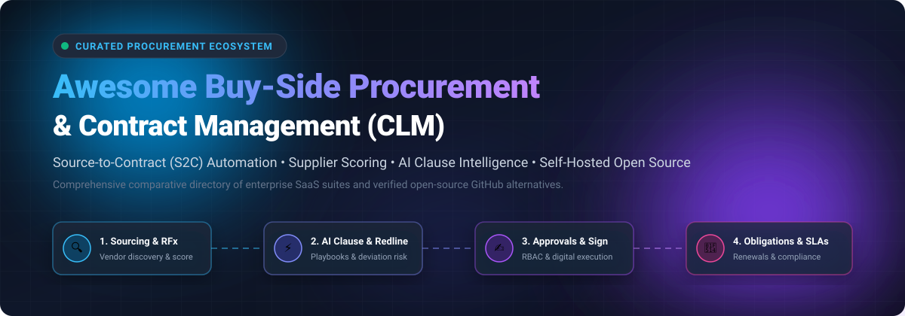

<p align="center">
  
</p>

# 📑 Awesome Buy-Side &amp; Procurement Contract Management

<p align="center">
  <a href="https://github.com/ishandutta2007/Awesome-Awesome-Awesome"></a><a href="https://discord.gg/jc4xtF58Ve"></a><a href="https://awesome.re"></a><a href="http://creativecommons.org/publicdomain/zero/1.0/"></a><a href="https://github.com/ishandutta2007/Awesome-Buy-Side-Procurement-Contract-Management/pulls"></a><a href="https://github.com/ishandutta2007"></a>
</p>

> 🎯 A curated, battle-tested list of leading **enterprise SaaS suites**, **Source-to-Contract (S2C)** platforms, and **open-source Contract Lifecycle Management (CLM)** tools designed for procurement leaders, legal counsels, CFOs, and software engineers.

---

## 🧭 Table of Contents

- [📊 Sector Overview & Market Dynamics](#-sector-overview--market-dynamics)
- [🏗️ Buy-Side Contract Lifecycle Architecture](#️-buy-side-contract-lifecycle-architecture)
- [🏢 SaaS & Enterprise Platforms](#-saas--enterprise-platforms)
  - [💼 SaaS Comparison & Pricing Matrix](#-saas-comparison--pricing-matrix)
  - [🔍 Detailed SaaS Profiles](#-detailed-saas-profiles)
- [💻 Open-Source GitHub Projects](#-open-source-github-projects)
  - [⭐ Open-Source Ecosystem Matrix (Ranked by Stars)](#-open-source-ecosystem-matrix-ranked-by-stars)
  - [🛠️ Deep-Dive: Open-Source Tools](#️-deep-dive-open-source-tools)
- [📐 Recommended Open-Source Architecture](#-recommended-open-source-architecture)
- [🤝 How to Contribute](#-how-to-contribute)
- [💖 Support & Sponsor](#-support--sponsor)
- [📈 Star History](#star-history)
- [⚖️ Disclaimer](#️-disclaimer)

---

## 📊 Sector Overview & Market Dynamics

The global Contract Lifecycle Management (CLM) and buy-side procurement software market is valued at approximately **$3.5 billion to $3.77 billion in 2026** and is projected to surge past **$8.7 billion to $9.7 billion by 2030** at an estimated CAGR of **12%–13%**.

The sector is **moderately fragmented**: rather than a singular winner-take-all monopoly, the market divides across multi-billion-dollar enterprise ERP incumbents (SAP, Workday), specialized pure-play CLMs (Icertis, Ironclad, Agiloft), and unified source-to-pay suites (Coupa, Jaggaer, GEP), leaving substantial room for niche legal-AI point solutions and self-hosted open-source alternatives.

---

## 🏗️ Buy-Side Contract Lifecycle Architecture

Buy-side procurement contracting spans four core continuous stages:

```
┌─────────────────┐       ┌─────────────────┐       ┌─────────────────┐       ┌─────────────────┐
│ 🔍 1. SOURCING  │  ──▶  │ ⚡ 2. AUTHORING │  ──▶  │ ✍️ 3. APPROVAL  │  ──▶  │ 🔔 4. OBLIGATION│
│    & RFx        │       │    & REDLINING  │       │    & SIGNING    │       │    & TRACKING   │
└─────────────────┘       └─────────────────┘       └─────────────────┘       └─────────────────┘
  • Vendor Intake           • AI Clause Scoring       • Dynamic Multi-RBAC      • SLA & Milestone Alert
  • RFP & Tenders           • Playbook Fallbacks      • Digital E-Signature     • Auto-Renewal Horizon
  • Supplier Scorecard      • MS Word / Online Sync   • Tamper-Evident Audit    • Spend Compliance
```

---

## 🏢 SaaS & Enterprise Platforms

### 💼 SaaS Comparison & Pricing Matrix

*Sorted in descending order by company scale (enterprise market capitalization or private equity valuation).*

| Platform | Category / Primary Focus | Company Scale (Valuation / Revenue) | Starting Tier Pricing | Free Tier / Free Trial Limits | Key Integrations |
| :--- | :--- | :--- | :--- | :--- | :--- |
| **[SAP Ariba Contracts](https://www.sap.com/)** | 🌐 Global S2C & Enterprise Procurement | **~$270B Market Cap** (FY25 Rev: €36.8B) | Starts at **$10,000/year** (bundled S2C subscription) | **Supplier Free Tier:** Free permanently for basic Standard accounts; capped at 5 documents or $50k transaction volume per customer (no buyer free tier) | SAP S/4HANA, SAP Business Network |
| **[Scout RFP (Workday Strategic Sourcing)](https://www.workday.com/)** | 📊 Strategic Sourcing & RFx Pipelines | **~$48B Market Cap** (FY26 Rev: $9.55B) | Starts at **$15,000/year** (module base fee) | **Free Trial:** 14-day guided sandbox access upon sales demo qualification (no perpetual free tier) | Workday Financials, Salesforce, NetSuite |
| **[Tipalti](https://tipalti.com/)** | 💳 Payables Automation & Procurement Approvals | **$8.3B Valuation** ($550M+ funding) | Starts at **$149/month** (base platform fee + transaction fees) | **Free Trial:** 14-day trial available via sales consultation and sandbox setup (no perpetual free tier) | NetSuite, QuickBooks, Xero |
| **[Coupa Procurement & CLM](https://www.coupa.com/)** | 🛒 Source-to-Contract & Business Spend Mgmt | **$8.0B Acquisition** (Thoma Bravo; ~$818M Rev) | Starts at **$25,000/year** (mid-market spend tier) | **Supplier Free Tier:** Coupa Supplier Portal (CSP) is permanently 100% free for vendors to receive POs and invoice; buyer platform has no free tier (sales-led POC only) | NetSuite, SAP, Oracle, Workday |
| **[Ironclad](https://ironcladapp.com/)** | 🤖 Digital Contracting & AI Negotiation | **$3.2B Valuation** ($200M+ ARR) | Starts at **$500/user/month** (minimum ~10 seats, ~$15,000–$30,000/year contract) | **Free Trial:** 14-day scoped pilot / proof-of-concept for qualified legal operations teams (no perpetual free tier) | Salesforce, Coupa, Google Docs, MS Word |
| **[Jaggaer Contracts](https://www.jaggaer.com/)** | ⚡ AI-Driven Procurement & CLM | **~$3.0B Acquisition** (Vista Equity Partners; ~$300M Rev) | Starts at **$20,000/year** (S2C module entry) | **Free Trial:** 30-day proof-of-concept environment upon enterprise RFP qualification (no perpetual free tier) | JAGGAER ONE, SAP, Oracle |
| **[Icertis Buy-Side CLM](https://www.icertis.com/)** | 🧠 Enterprise Contract Intelligence & Obligations | **$2.8B–$5.0B Valuation** (~$250M+ ARR) | Starts at **$40,000/year** (~$100,000+/year typical enterprise deployment) | **Free Trial:** 30-day customized sandbox environment for qualified enterprise evaluations (no perpetual free tier) | SAP, Microsoft Dynamics 365, Salesforce |
| **[GEP SMART](https://www.gep.com/)** | 📦 Unified Source-to-Pay & Supply Chain | **~$2.6B Annual Revenue** (Founder-backed) | Starts at **$30,000/year** (procurement suite base tier) | **Free Trial:** Custom 14-day guided proof-of-concept pilot for qualified procurement teams (no perpetual free tier) | SAP, Oracle ERP Cloud, Microsoft |
| **[Agiloft Procurement CLM](https://www.agiloft.com/)** | 🧩 No-Code CLM & Contract Intelligence | **~$1.0B+ Valuation** (KKR majority buyout) | Starts at **$65/user/month** (Astra AI Pro starts at **$120/month**) | **Free Tier:** Agiloft Astra AI has a **permanent Free Tier** with unlimited users, 1,000 AI credits/month, MS Word Add-In, and 3 custom playbooks (Core CLM has 14-day trial on request) | MS Word Online, Salesforce, Jira |
| **[Zycus](https://www.zycus.com/)** | 🤖 Cognitive Agentic CLM (Merlin AI) | **~$300M–$360M Revenue** (Self-funded global enterprise) | Starts at **$24,000/year** (entry S2C package) | **Free Trial:** Guided 14-day interactive Merlin AI sandbox session upon demo request (no perpetual free tier) | SAP, Oracle, Microsoft Dynamics |

---

### 🔍 Detailed SaaS Profiles

- **[SAP Ariba Contracts](https://www.sap.com/)** 🏢  
  Global enterprise contracting backbone integrated with SAP Ariba Sourcing, Buying, and Invoicing. Standardizes clause repositories, handles Word redlining, enforces contractual pricing during purchase order creation, and automates supplier compliance.
- **[Scout RFP (Workday Strategic Sourcing)](https://www.workday.com/)** 🎯  
  Collaborative cloud sourcing application streamlining RFPs, reverse auctions, vendor engagement, and contract renewals directly into Workday Financial Management.
- **[Tipalti](https://tipalti.com/)** 💳  
  Automates end-to-end procurement, supplier tax compliance, purchase approvals, and cross-border payments across 196 countries in 120 currencies with automated renewal tracking.
- **[Coupa Procurement & CLM](https://www.coupa.com/)** 🛒  
  Enterprise Business Spend Management (BSM) platform with embedded AI contract intelligence that extracts operational metadata, calculates vendor risk scores, and routes contract approvals.
- **[Ironclad](https://ironcladapp.com/)** 🤖  
  Digital contracting platform favored by high-growth legal operations and procurement teams. Offers an interactive Contract Editor, workflow builder, automated redline comparisons, and AI contract summarization.
- **[Jaggaer Contracts](https://www.jaggaer.com/)** ⚡  
  AI-enabled Contract Lifecycle Management suite within JAGGAER ONE featuring automated third-party paper intake, clause variance detection, SLA monitoring, and dynamic risk assessment.
- **[Icertis Buy-Side Contract Management](https://www.icertis.com/)** 🧠  
  IDC MarketScape Leader turning contracts into strategic operational assets. Features GenAI copilots for contract drafting, third-party paper risk scoring, and obligation realization to prevent value leakage.
- **[GEP SMART](https://www.gep.com/)** 📦  
  Cloud-native unified source-to-pay platform delivering centralized contract repository control, real-time spend analytics, and automated vendor performance governance.
- **[Agiloft Procurement CLM](https://www.agiloft.com/)** 🧩  
  Data-first, no-code CLM platform allowing procurement teams to build custom approval logic, integrate seamlessly with Microsoft Word, and leverage Astra AI for automated clause classification.
- **[Zycus](https://www.zycus.com/)** 🤖  
  Equipped with Merlin AI autonomous agents that read supplier contracts, score deviations against enterprise playbooks, extract commitments, and track post-signature rebates automatically.

---

## 💻 Open-Source GitHub Projects

### ⭐ Open-Source Ecosystem Matrix (Ranked by Stars)

*Sorted in descending order by GitHub stargazer count.*

| Project | GitHub Stars Badge | License | Primary Category & Capabilities | Tech Stack |
| :--- | :--- | :--- | :--- | :--- |
| **[Odoo](https://github.com/odoo/odoo)** | [](https://github.com/odoo/odoo/stargazers) | LGPL-3.0 | 📦 Comprehensive ERP suite with vendor procurement, purchase agreements, and RFQ tenders | Python, JavaScript, PostgreSQL |
| **[ERPNext](https://github.com/frappe/erpnext)** | [](https://github.com/frappe/erpnext/stargazers) | GPL-3.0 | 🏭 Full-scale ERP with supplier management, contract registers, PO approvals, and bidding | Python, Frappe, MariaDB |
| **[DocuSeal](https://github.com/docusealco/docuseal)** | [](https://github.com/docusealco/docuseal/stargazers) | AGPL-3.0 | ✍️ Self-hosted digital document signing, PDF form fields, and cryptographic verification | Ruby, JavaScript, PostgreSQL |
| **[Documenso](https://github.com/documenso/documenso)** | [](https://github.com/documenso/documenso/stargazers) | AGPL-3.0 | 📝 Open-source DocuSign alternative for legal contracting, webhook automation, and signing | TypeScript, Next.js, Prisma |
| **[Invoice Ninja](https://github.com/invoiceninja/invoiceninja)** | [](https://github.com/invoiceninja/invoiceninja/stargazers) | Elastic-2.0 | 💵 Vendor expense tracking, quote-to-invoice workflows, and payment gateway automation | PHP, Laravel, Flutter |
| **[Dolibarr](https://github.com/Dolibarr/dolibarr)** | [](https://github.com/Dolibarr/dolibarr/stargazers) | GPL-3.0 | 📋 Modular ERP/CRM with dedicated supplier contracts module and recurring subscription tracking | PHP, MySQL/PostgreSQL |
| **[OpenSign](https://github.com/OpenSignLabs/OpenSign)** | [](https://github.com/OpenSignLabs/OpenSign/stargazers) | AGPL-3.0 | 🔏 Free and open-source PDF electronic signature platform with multi-party routing | TypeScript, Node.js, React, MongoDB |
| **[OpenCost](https://github.com/opencost/opencost)** | [](https://github.com/opencost/opencost/stargazers) | Apache-2.0 | 📊 Open-source cloud spend monitoring, vendor infrastructure contract tracking, and Kubernetes cost allocation | Go, TypeScript, Prometheus |
| **[OpenContracts](https://github.com/JSv4/OpenContracts)** | [](https://github.com/JSv4/OpenContracts/stargazers) | Apache-2.0 | 📑 Legal document analytics, clause annotation, contract extraction, and layout parsing | Python, Django, TypeScript |
| **[draftLegal](https://github.com/AniketTati/draft-legal)** | [](https://github.com/AniketTati/draft-legal/stargazers) | MIT | 🤖 Self-hosted AI-native CLM (Ironclad + Harvey alternative) with vector search & 30+ contract tools | Python, FastAPI, pgvector, React |
| **[Aakd](https://github.com/aaked-app/aakd)** | [](https://github.com/aaked-app/aakd/stargazers) | AGPL-3.0 | 🔔 Post-signature obligation tracker, renewal milestones, audit evidence, and MCP integration | Node.js, TypeScript, REST API |
| **[VendorBridge-AI](https://github.com/vatsalgajera-tech/VendorBridge-AI)** | [](https://github.com/vatsalgajera-tech/VendorBridge-AI/stargazers) | MIT | 🤝 AI procurement ERP with quotation comparison, delivery scoring, and purchase order cycles | Python, React, AI scoring models |
| **[OpenTradeIntel](https://github.com/b2baitrade-ui/opentradeintel)** | [](https://github.com/b2baitrade-ui/opentradeintel/stargazers) | MIT | 🇪🇺 Sourcing intelligence engine mining EU TED public tenders and matching supplier catalogs | Python, FastAPI, CLI |

---

### 🛠️ Deep-Dive: Open-Source Tools

- **[Odoo Purchase & Contracts](https://github.com/odoo/odoo)** 📦  
  Provides full source-to-pay automation: manage vendor price lists, automate purchase tenders, create blanket orders, track legal agreements, and verify supplier invoices with 3-way matching.
- **[ERPNext](https://github.com/frappe/erpnext)** 🏭  
  Open-source enterprise resource planning suite equipped with complete procurement pipelines: RFQ dissemination, supplier quotation comparisons, auto-generated purchase orders, and supplier contract master data.
- **[DocuSeal](https://github.com/docusealco/docuseal)** ✍️  
  Lightweight, self-hosted document signing engine. Easily embed signature requests into procurement portals, with mobile-friendly form filling and full cryptographic signing audits.
- **[Documenso](https://github.com/documenso/documenso)** 📝  
  Modern digital signing infrastructure built with Next.js and Prisma. Ideal for embedding legally binding contract signature workflows directly inside web applications.
- **[Invoice Ninja](https://github.com/invoiceninja/invoiceninja)** 💵  
  Self-hosted financial suite for tracking vendor expenses, purchase quotes, auto-billing subscriptions, and managing vendor payables.
- **[Dolibarr ERP/CRM](https://github.com/Dolibarr/dolibarr)** 📋  
  Modular platform featuring supplier contract tracking, milestone scheduling, delivery terms recording, and purchase order dispatch.
- **[OpenSign](https://github.com/OpenSignLabs/OpenSign)** 🔏  
  Feature-rich open-source e-signature solution supporting multi-party sequential signing, OTP signer validation, and document template management.
- **[OpenCost](https://github.com/opencost/opencost)** 📊  
  Vendor cloud infrastructure cost allocation tool built on OpenCost standards, providing real-time visibility into supplier cloud commitments and compute spend.
- **[OpenContracts](https://github.com/JSv4/OpenContracts)** 📑  
  Enterprise document analytics and layout parser tailored for legal documents. Annotates clauses, detects definitions, and extracts contractual terms from complex PDFs.
- **[draftLegal](https://github.com/AniketTati/draft-legal)** 🤖  
  AI-native CLM providing autonomous agent chat over contractual repositories, automated redline recommendations against playbooks, and citation-backed extraction without sending data off-premise.
- **[Aakd](https://github.com/aaked-app/aakd)** 🔔  
  Specialized post-signature CLM focusing on operationalizing executed documents: obligation assignment, calendar sync, renewal notification triggers, and Model Context Protocol (MCP) agent connectivity.
- **[VendorBridge-AI](https://github.com/vatsalgajera-tech/VendorBridge-AI)** 🤝  
  Procurement automation platform evaluating vendor bids across price, delivery SLA, and historical ratings with structured managerial approval gates.
- **[OpenTradeIntel](https://github.com/b2baitrade-ui/opentradeintel)** 🇪🇺  
  Public procurement tender parser fetching live TED (Tenders Electronic Daily) notices across the European Union and ranking opportunities against domestic supplier catalogs.

---

## 📐 Recommended Open-Source Architecture

Build an end-to-end, enterprise-grade, self-hosted Source-to-Contract pipeline with zero per-seat licensing fees:

```
┌────────────────────────────────────────────────────────────────────────┐
│                   1. Sourcing & Supplier Matching                      │
│       VendorBridge-AI (RFQs & Scoring)  |  OpenTradeIntel (Tenders)    │
└───────────────────────────────────┬────────────────────────────────────┘
                                    │
                                    ▼
┌────────────────────────────────────────────────────────────────────────┐
│                   2. Contract Authoring & AI Redlining                 │
│         draftLegal (AI Playbooks)  |  OpenContracts (Clause NLP)       │
└───────────────────────────────────┬────────────────────────────────────┘
                                    │
                                    ▼
┌────────────────────────────────────────────────────────────────────────┐
│                   3. Approvals, POs & Digital Signing                  │
│       Odoo / ERPNext (Approvals & ERP)  |  DocuSeal / OpenSign (Sign)  │
└───────────────────────────────────┬────────────────────────────────────┘
                                    │
                                    ▼
┌────────────────────────────────────────────────────────────────────────┐
│              4. Post-Signature Obligations & Spend Audits              │
│       Aakd (Obligations & MCP)  |  OpenCost (Cloud Contract Spend)     │
└────────────────────────────────────────────────────────────────────────┘
```

---

## 🤝 How to Contribute

Contributions are warmly encouraged! To propose a tool, update pricing, or refine benchmarks:

1. 🍴 Fork this repository.
2. 📝 Update [`README.md`](README.md) following the existing Markdown tables and badge formats.
3. 🔎 Ensure all SaaS listings include specific starting prices, accurate free tier/trial limits, and company scale metrics.
4. ⭐ For open-source projects, include the social stars badge linked to `/stargazers`.
5. 🚀 Open a Pull Request with a clear description of your additions!

---

## 💖 Support & Sponsor

If you find this repository valuable for your procurement operations, legal tech stack, or engineering architecture, please consider supporting the project:

- ⭐ **Star the repo** on GitHub to help others discover it!
- 🍴 **Fork and share** with fellow procurement and legal ops practitioners.
- ☕ **Buy me a coffee / Sponsor development:**  
  [](https://github.com/sponsors/ishandutta2007)

Your support helps keep this directory actively curated and updated!

---

##  Star History

[](https://www.star-history.com/#ishandutta2007/Awesome-Buy-Side-Procurement-Contract-Management&type=date&legend=top-left)

---

## ⚖️ Disclaimer

- This repository is a community-curated directory compiled for research and educational purposes; it does not constitute formal legal, financial, or procurement advisory.
- Enterprise software pricing, subscription terms, and trial durations change frequently; verify directly with each vendor.
- Self-hosted open-source software deployments handling contractual data should adhere strictly to internal data governance policies, access controls, and applicable statutory frameworks (e.g., GDPR, SOC 2, HIPAA).
